# PhysicsBlock3D

基于**体素网格**的 3D 刚体物理引擎，由 `PixelClean/PhysicsBlock/`（2D 像素网格版）
逐类改写而来。支持网格形状体、粒子、球体、胶囊线段、关节约束、绳索/弹簧连接、
静态/动态地图碰撞检测，以及基于**八叉树**的网格搜索加速。

- 全部符号位于 `namespace PhysicsBlock3D`，全部宏带 `3D` 后缀 —— 可与 2D 版
  共存于同一个可执行文件而不冲突。
- 逐类对照关系、维度映射与改写过程中修掉的 2D 既有缺陷见
  [`PhysicsBlock3D转换对照表.md`](PhysicsBlock3D转换对照表.md)。
- 本库**只做物理**，不含任何画面渲染（与 2D 版一致）。

---

## 三个必须理解的 3D 语义变更

1. **惯量张量随朝向变化**。2D 的 `Izz` 与朝向无关；3D 的 `MomentInertia` /
   `invMomentInertia` 存**局部系**，任何"用 `invI` 乘世界系向量"的地方都必须走
   `PhysicsAngle3D::WorldInvInertia()`（= `R * invMomentInertia * transpose(R)`）。
2. **`glm::angleAxis(angle, axis)` 内部已取半角**（`w = cos(a/2)`）。因此
   `QuatFromAngularVelocity(ω, dt)` 必须传**完整转角** `|ω|*dt`。
3. **接触法线约定**：`Contact3D::normal` 一律**由 object1 指向 object2**，与求解器
   `dv = v2 - v1`、`dPn = massNormal*(-vn + bias)` 自洽。

---

## 类继承关系

```mermaid
graph TD

    BaseSerialization3D(BaseSerialization3D<br/>JSON序列化基类)
    BaseGrid3D(BaseGrid3D<br/>基础体素网格)
    BaseOutline3D(BaseOutline3D<br/>表面轮廓)
    MapStatic3D(MapStatic3D<br/>静态地图)
    MapDynamic3D(MapDynamic3D<br/>动态地图)
    MapFormwork3D(MapFormwork3D<br/>地图模板接口)

    PhysicsFormwork3D(PhysicsFormwork3D<br/>刚体物理模板)
    PhysicsParticle3D(PhysicsParticle3D<br/>物理粒子)
    PhysicsAngle3D(PhysicsAngle3D<br/>物理角度/四元数)
    PhysicsCircle3D(PhysicsCircle3D<br/>物理球)
    PhysicsLine3D(PhysicsLine3D<br/>物理胶囊线段)
    PhysicsShape3D(PhysicsShape3D<br/>物理形状体)

    BaseArbiter3D(BaseArbiter3D<br/>碰撞裁决基类)
    PhysicsBaseArbiterAA3D(PhysicsBaseArbiterAA3D<br/>Angle↔Angle)
    PhysicsBaseArbiterAD3D(PhysicsBaseArbiterAD3D<br/>Angle↔Particle)
    PhysicsBaseArbiterA3D(PhysicsBaseArbiterA3D<br/>Angle↔地图)
    PhysicsBaseArbiterD3D(PhysicsBaseArbiterD3D<br/>Particle↔地图)
    PhysicsArbiterSS3D(PhysicsArbiterSS3D<br/>Shape↔Shape)
    PhysicsArbiterSP3D(PhysicsArbiterSP3D<br/>Shape↔Particle)
    PhysicsArbiterCS3D(PhysicsArbiterCS3D<br/>Circle↔Shape)
    PhysicsArbiterCC3D(PhysicsArbiterCC3D<br/>Circle↔Circle)
    PhysicsArbiterCP3D(PhysicsArbiterCP3D<br/>Circle↔Particle)
    PhysicsArbiterLC3D(PhysicsArbiterLC3D<br/>Line↔Circle)
    PhysicsArbiterLS3D(PhysicsArbiterLS3D<br/>Line↔Shape)
    PhysicsArbiterLP3D(PhysicsArbiterLP3D<br/>Line↔Particle)
    PhysicsArbiterS3D(PhysicsArbiterS3D<br/>Shape↔地图)
    PhysicsArbiterP3D(PhysicsArbiterP3D<br/>Particle↔地图)
    PhysicsArbiterC3D(PhysicsArbiterC3D<br/>Circle↔地图)
    PhysicsArbiterL3D(PhysicsArbiterL3D<br/>Line↔地图)

    BaseJunction3D(BaseJunction3D<br/>连接约束基类)
    PhysicsJunctionSS3D(PhysicsJunctionSS3D<br/>Angle↔Angle)
    PhysicsJunctionS3D(PhysicsJunctionS3D<br/>Angle↔固定点)
    PhysicsJunctionP3D(PhysicsJunctionP3D<br/>Particle↔固定点)
    PhysicsJunctionPP3D(PhysicsJunctionPP3D<br/>Particle↔Particle)

    PhysicsJoint3D(PhysicsJoint3D<br/>物理关节)
    GridSearch3D(GridSearch3D<br/>八叉网格搜索)
    PhysicsWorld3D(PhysicsWorld3D<br/>物理世界)

    BaseSerialization3D --> BaseGrid3D
    BaseGrid3D --> BaseOutline3D
    BaseGrid3D --> MapStatic3D
    MapFormwork3D -.-> MapStatic3D
    BaseGrid3D --> MapDynamic3D
    MapFormwork3D -.-> MapDynamic3D

    BaseOutline3D --> PhysicsShape3D
    PhysicsFormwork3D --> PhysicsParticle3D
    PhysicsParticle3D --> PhysicsAngle3D
    PhysicsAngle3D --> PhysicsCircle3D
    PhysicsAngle3D --> PhysicsLine3D
    PhysicsAngle3D --> PhysicsShape3D

    BaseArbiter3D --> PhysicsBaseArbiterAA3D
    BaseArbiter3D --> PhysicsBaseArbiterAD3D
    BaseArbiter3D --> PhysicsBaseArbiterA3D
    BaseArbiter3D --> PhysicsBaseArbiterD3D
    PhysicsBaseArbiterAA3D --> PhysicsArbiterSS3D
    PhysicsBaseArbiterAA3D --> PhysicsArbiterCS3D
    PhysicsBaseArbiterAA3D --> PhysicsArbiterCC3D
    PhysicsBaseArbiterAA3D --> PhysicsArbiterLC3D
    PhysicsBaseArbiterAA3D --> PhysicsArbiterLS3D
    PhysicsBaseArbiterAD3D --> PhysicsArbiterSP3D
    PhysicsBaseArbiterAD3D --> PhysicsArbiterCP3D
    PhysicsBaseArbiterAD3D --> PhysicsArbiterLP3D
    PhysicsBaseArbiterA3D --> PhysicsArbiterS3D
    PhysicsBaseArbiterA3D --> PhysicsArbiterC3D
    PhysicsBaseArbiterA3D --> PhysicsArbiterL3D
    PhysicsBaseArbiterD3D --> PhysicsArbiterP3D
    BaseJunction3D --> PhysicsJunctionSS3D
    BaseJunction3D --> PhysicsJunctionS3D
    BaseJunction3D --> PhysicsJunctionP3D
    BaseJunction3D --> PhysicsJunctionPP3D
```



**组合关系**：`PhysicsWorld3D` 持有 `MapFormwork3D*`、7 个对象 vector
（Shape/Particle/Circle/Line/Joint/Junction/Assembly）、`GridSearch3D`、
`CollideGroupS`（裁决器哈希表），以及三个子系统
`PhysicsCollision3D` / `PhysicsKinematic3D` / `PhysicsTrigger3D`。

---

## 每帧仿真流程（`PhysicsWorld3D::PhysicsEmulator`，九阶段）

```
① 等待上一帧异步入队的 xTn + ResolveCollideGroup()
② 多线程 XT_Fun 碰撞检测：ShapeS / CircleS / LineS / ParticleS 四子扫描
   （ParticleS 只做「粒子↔地图」，不进网格宽相）
③ inv_dt = 1 / time
④ PhysicsSpeed  ——  多线程积分速度（重力已在其中；约束求解之前）
⑤ PreStep        ——  串行：CollideGroupVector → PhysicsJointS → BaseJunctionS
⑥ ApplyImpulse   ——  多线程迭代 ApplyImpulseSize 轮，每轮全屏障
⑦ PhysicsPos     ——  多线程积分位置 + Kinematic 运动
⑧ 后处理          ——  ProcessCollisions → ProcessTriggers → 网格增量重建
   → [液体，默认关闭] → 异步入队下一帧碰撞检测（故意不等待）
⑨ 耗时统计
```

> 多线程 PreStep 在 2D 中就被 `#if (Definite != 1) & ThreadPoolBool & 0` **永久编译掉**
> （PreStep 含冲量副作用，多线程无法收敛静止物体且增加不确定性），3D 沿用该决定。

---

## 文件索引

### 基础 / 类型

| 文件 | 说明 |
|---|---|
| `BaseDefine3D.h` | 常量宏：接触上限、休眠阈值、阻尼换算、像素块边长、流形上限 |
| `BaseStruct3D.hpp` | `Vec3_/Mat3_/Quat_/IVec3_` 别名、`GridBlock3D`、`CollisionInfoI3D/D3D`、`DirectionNormal`、四元数工具 |
| `PhysicsBlockTypes3D.hpp` | `Bounds3D`、回调 typedef、`BulletHitInfo3D`、`DirectionFromNormal`、异常类 |
| `BaseSerialization3D.hpp` | JSON 序列化宏（Vec3/IVec3/Quat/Mat3）与基类 |
| `MemoryPool3D.h` | 对象内存池（修正了 2D `Tool/MemoryPool.h` 的成员名笔误） |

### 数学

| 文件 | 说明 |
|---|---|
| `BaseCalculate3D.hpp/.cpp` | 向量/几何工具、`LineBoxFocus`、`BoxToBox`、`Morton3D`、SAT、面裁剪、摩擦圆盘、对称求逆 |

### 网格 / 轮廓 / 空间索引

| 文件 | 说明 |
|---|---|
| `BaseGrid3D.hpp/.cpp` | 体素网格基类 + **三维 DDA（Amanatides-Woo）** |
| `BaseOutline3D.hpp/.cpp` | 表面轮廓点集（`OutlinePoint3D`：位置/法线/摩擦/射线种子/体素） |
| `GridSearch3D.hpp` | **八叉树**网格搜索（哈希格表 + 层基 8 + 64 位 Morton3D） |

### 地图

| 文件 | 说明 |
|---|---|
| `MapFormwork3D.hpp/.cpp` | 地图模板接口（`MapOutline3D` 面中心 + 外向法线） |
| `MapStatic3D.hpp/.cpp` | 静态体素地图 |
| `MovePlate3D.h` | 三维板块滚动容器（Z→Y→X 顺序，内存配对修正） |
| `MapDynamic3D.hpp/.cpp` | 动态地图（16³ 板块 + 贪心立方体分配 + Morton3D 落位） |

### 对象

| 文件 | 说明 |
|---|---|
| `PhysicsFormwork3D.hpp` | 刚体接口（虚析构已修正） |
| `PhysicsParticle3D.hpp/.cpp` | 质点：位置/速度/受力/质量 |
| `PhysicsAngle3D.hpp/.cpp` | 带朝向的刚体：四元数 + 3×3 惯量张量 + `WorldInvInertia()` |
| `PhysicsShape3D.hpp/.cpp` | 网格形状体（体素 → 质量/质心/惯量/轮廓） |
| `PhysicsCircle3D.hpp/.cpp` | 球体（`I = 0.4mr²`，实心球） |
| `PhysicsLine3D.hpp/.cpp` | 胶囊线段（`GetSegment`，胶囊惯量公式） |

### 碰撞 / 约束

| 文件 | 说明 |
|---|---|
| `BaseArbiter3D.hpp` | `Contact3D`（双切向 + 特征 ID 热启动）、`ArbiterKey3D`、裁决基类、内存池常量 |
| `PhysicsBaseCollide3D.hpp/.cpp` | 窄相：7 个 `CollideAABB` + 12 个 `Collide`、流形归约、特征 ID |
| `PhysicsBaseArbiter3D.hpp/.cpp` | 四类求解器（AA/AD/A/D）：有效质量、Baumgarte、摩擦圆盘、按特征热启动 |
| `PhysicsArbiter3D.hpp/.cpp` | 12 个具体裁决器 |
| `PhysicsJoint3D.hpp/.cpp` | 3 DOF 关节（`Skew(r)·I⁻¹·Skew(r)ᵀ`） |
| `PhysicsJunction3D.hpp/.cpp` | 绳索/弹簧/杠杆/橡胶约束（四种对象组合） |
| `EnergyConservation3D.hpp` | 完全弹性能量守恒碰撞（粒子版 + 刚体冲量版） |

### 子系统

| 文件 | 说明 |
|---|---|
| `PhysicsCollision3D.hpp/.cpp` | 碰撞/地形/地图变更事件分发 |
| `PhysicsKinematic3D.hpp/.cpp` | 运动学对象（位置 Lerp + 四元数 slerp） |
| `PhysicsTrigger3D.hpp/.cpp` | 触发器（Enter/Stay/Exit 状态机、层级过滤、球盒重叠） |
| `PhysicsAssembly3D.hpp/.cpp` | 组装体（成员互不碰撞） |
| `MovementUtil3D.hpp` | 移动到目标速度的力计算、`SmoothK3D`、`LerpRotation3D` |

### 世界

| 文件 | 说明 |
|---|---|
| `PhysicsWorld3D.hpp` | 世界类：容器、内存池宏、线程池、`AddObject`/`RemoveObject` |
| `PhysicsWorld3D.cpp` | 九阶段 `PhysicsEmulator`、`PhysicsInformationUpdate`、裁决器生命周期 |
| `PhysicsWorld3DSerialization.cpp` | JSON 序列化 / 反序列化 / 对象索引解析 |

### 调试（可选，不参与仿真）

| 文件 | 说明 |
|---|---|
| `ImGuiPhysics3D.hpp/.cpp` | ImGui 检视面板（位置/速度/力/轮廓/惯量/网格编辑器） |
| `PhysicsAuxiliaryVision3D.hpp/.cpp` | 线框调试渲染（依赖 `VulkanTool/AuxiliaryVision.h`） |

---

## 使用示例

```cpp
#include "PhysicsWorld3D.hpp"
#include "MapStatic3D.hpp"
#include "PhysicsShape3D.hpp"

using namespace PhysicsBlock3D;

// 1. 世界（重力 -Y 向下）
PhysicsWorld3D world(Vec3_(0.0f, -9.81f, 0.0f), /*wind=*/false);

// 2. 静态地形：32×32×32 体素，y=0 整层作为地面
MapStatic3D *map = new MapStatic3D(32, 32, 32);
for (unsigned int x = 0; x < 32; ++x)
    for (unsigned int z = 0; z < 32; ++z)
    {
        GridBlock3D &b = map->at(x, 0, z);
        b.Entity = true;
        b.Collision = true;
        b.mass = FLOAT_MAX; // 静态
    }
world.SetMapFormwork(map);   // 内部会注入碰撞变更回调并 SetMapRange

// 3. 一个球
PhysicsCircle3D *ball = new PhysicsCircle3D(Vec3_(16.0f, 20.0f, 16.0f), 1.0f, 1.0f, 0.4f);
world.AddObject(ball);

// 4. 一个网格形状体（2×2×2 体素）
PhysicsShape3D *box = new PhysicsShape3D(Vec3_(10.0f, 20.0f, 10.0f), IVec3_(2, 2, 2));
for (unsigned int x = 0; x < box->width; ++x)
    for (unsigned int y = 0; y < box->height; ++y)
        for (unsigned int z = 0; z < box->depth; ++z)
        {
            GridBlock3D &b = box->at(x, y, z);
            b.Entity = true;
            b.Collision = true;
            b.mass = 1.0f;
        }
box->UpdateAll();   // 由体素计算质量/质心/惯量张量/轮廓
world.AddObject(box);

// 5. 步进
const FLOAT_ dt = 1.0f / 60.0f;
for (int frame = 0; frame < 600; ++frame)
{
    world.PhysicsEmulator(dt);
    world.UpdateGridPosition(ball->pos);   // 网格跟随焦点
}
```

### 捕获碰撞事件

```cpp
// 物体 ↔ 物体
world.GetCollision().AddCollisionEnterListener(ball,
    [](const PhysicsFormwork3D *self, const PhysicsFormwork3D *other,
       const BaseArbiter3D *) { /* ... */ });

// 物体 ↔ 地图（注意走的是另一套监听器）
world.GetCollision().AddMapCollisionEnterListener(map,
    [](const PhysicsFormwork3D *self, const MapFormwork3D *mapObj,
       const BaseArbiter3D *) { /* ... */ });
```

> **重要**：`PhysicsCollision3D::AddCollisionPair` 按裁决器类型分派 ——
> 物体↔物体走 `AddCollision*Listener`，物体↔地图走 `AddMapCollision*Listener`。
> 这是 2D 既有语义，不是缺陷。

---

## 编译

### 由主工程构建（推荐）

`PixelClean/CMakeLists.txt` 已接入：

```cmake
add_subdirectory(PhysicsBlock)      # 2D 版
add_subdirectory(PhysicsBlock3D)    # 3D 版
...
target_link_libraries(PixelClean ... PhysicsBlockLib PhysicsBlock3DLib ...)
```

`PhysicsBlock3D/CMakeLists.txt` 用 `file(GLOB_RECURSE ... *.cpp)` 收集全部实现，
只复用 `Tool/` 的 `ThreadPool.h` / `json.hpp`（内存池用本目录修正过的
`MemoryPool3D.h`），**明确不含 PhysicsGPU**。

### 独立编译并运行验证

本仓库自带两个验证程序（未纳入版本库，位于构建目录）：

```sh
# 集成测试：地形 + 球 + 形状体 + 粒子 + 关节 + 绳索 + 触发器 + 运动学 + 组装体
sh build.sh -l t14.cpp <PhysicsBlock3D 下全部 .cpp>

# 序列化往返：序列化 → 反序列化 → 再跑 120 帧
sh build.sh -l t15.cpp <PhysicsBlock3D 下全部 .cpp>
```

两者均输出 `ALL TESTS PASSED (fail=0)`。

---

## 验证记录

本目录的代码全部**实际编译、链接并运行**过（本机无 cmake/gcc，用 Android NDK clang 交叉编译）。

| 验证项 | 结果 |
|---|---|
| 全树编译（25 个 `.cpp`，含两个调试类与液体桩） | **OK=25 / FAILED=0** |
| 2D/3D 同二进制共存（同一 TU 同时 include 两套引擎并链接） | **零符号冲突**，输出 `COEXIST OK` |
| 集成测试 `t14`：世界 + 静态地图 + 球/形状/粒子/线段 + 关节 + 连接 + 组装体 + 运动学 + 触发器 + 碰撞回调，跑 420 帧后序列化往返再跑 120 帧 | **ALL TESTS PASSED** |
| 长跑稳定性 `t16`：封闭场地内 8 球堆 + 3³ 方块 + 粒子，**3000 帧** | **ALL TESTS PASSED**（无 NaN/Inf、无穿透、无速度爆炸，末态全部静止、`energy=0.00225`，`CollideGroupS` 与 `CollideGroupVector` 长度始终一致） |
| 堆叠诊断 `t17`：1~4 球垂直堆叠 | 逐球稳定停在 `y = 2.00 / 3.99 / 5.99 / 7.98`（间距恰为直径），无抖动 |
| `EnergyConservation3D` 单元测试 | **10 项全过**（动量/动能守恒、切向不参与、重合不产生 NaN） |
| 求解器 `t7`：动量守恒、Baumgarte 偏置、摩擦圆盘饱和、静态体不被推动、偏心自旋、世界系共轭惯量 | **8 项全过** |
| 地图 `t10`/`t11`：静态/动态地图的轮廓、三维 DDA、板块滚动、碰撞通知 | **全过** |
| 网格 `t3`/`t9`：三维 DDA 六面法线、`GridSearch3D` 增删查与超大对象回落 | **全过** |
| 约束 `t12`/`t13`：关节锚点收敛、各向异性响应、绳/杠杆/弹簧行为、两端重合不产生 NaN | **全过** |
| 液体 `t18`：216 粒子 + 地形/围墙，240 帧 | **通过**（无 NaN/Inf、粒子数不变、`minY` 精确 = 地板顶面 2.0、`max|v|` 有界） |
| 液体 `t19`：零重力精确点阵首帧密度 | **max = 74.09，与解析值 73.9 吻合** —— 证明 poly6 核、幅度 `315/(64πh⁹)`、邻居搜索、`restDensity` 标定全部正确 |
| 液体 `t20`/`t21`：`cohesion`/`curvature` 逐项隔离，**3D 与 2D 对照跑同一场景** | 两者行为一致（全关时点阵都精确静止 1.200；单开曲率都膨胀；默认双开都轻微膨胀）⇒ 膨胀是 2D 既有本构特性，**非 3D 移植引入的错误** |

---

## 已知的未移植部分

| 模块 | 状态 | 原因 |
|---|---|---|
| `PhysicsLiquid`（PBF 液体） | **已完成**；`#if PhysicsLiquid3DBool3D` 默认 **1**（开启），置 0 可整段排除 | 2D 是 Position Based Fluids。3D 化的关键换算：核常数 `4/(πh⁸)`→`315/(64πh⁹)`、`10/(πh⁵)`→`45/(πh⁶)`；`restDensity` 按 3D 点阵（7×7×7）重标定：`r=0.15` 时 `ρ₀=71.9514618`（**2D 的 16.66667 只对二维体积元成立，沿用会让 `C=ρ/ρ0−1≈3.3` 直接爆开**）；`kMaxNeighbors` 64→**160**（3D 球内约 57~61 个邻居，64 只余 ≤12% 余量）；`kMaxSolidSamples` 4096→**16384**（2D 每体素 per²=16 点 → 3D per³=64 点）；邻域 `3×3`→**3×3×3**；边界探测 `8`→**26** 方向（轴/面对角/体对角全部单位化）；刚体拟合由标量 `dθ=Σ(r×d)/Σr²` → `L=Σ(r×d)`、`M=Σ(|r|²I₃−r⊗r)`、`dθ=M⁻¹·L`（3×3 求逆 + 奇异保护），转动用四元数左乘合成；圆采样由同心环面积填充 → 球体体积点阵填充；线段 → 沿 `GetSegment` 的胶囊采样 |
| `PhysicsGPU`（Vulkan 冲量迭代） | **明确排除** | 三个 compute shader（`physics_arbiter.comp` / `physics_joint.comp` / `physics_junction.comp`）全部硬编码 2D（`BODY_STRIDE 8`、`cross2D`、`tangent = vec2(normalY,-normalX)`）。三维化须把 body stride 从 8 扩到 18~21 并重写 `cross3` 与 3×3 逆惯量。代价仅失去冲量迭代的 GPU 加速，**CPU 多线程路径完整保留** |

**已知的液体行为边界（如实记录，非缺陷）**：PBF 的密度约束 `C=ρ/ρ0−1` 在本实现里是
**单边**的（`c<0` 时 `λ=0`，"只压不拉"），故材料**抗张刚度为 0**。后果是：在
"零重力 + 无容器 + 自由表面"这种病态配置下，有限液体团首帧获得一次净向外的冲量后
没有任何回复力，会**匀速飞散**（能量有界、速度停在常数，不是数值爆炸；其中曲率项是主要
净外向驱动）。**一旦有重力或围墙提供围压，该现象完全消失** —— 容器实验中 0/500 帧穿地、
0 次 CFL 钳制、密度中位数 ±1%、`1428/1728` 个粒子落在 `ρ0±10%`。
该"只压不拉"本构与表面张力公式均**逐字继承自 2D 版（而 2D 版又继承自 Floaty 参考实现）**，
并非 3D 移植引入：同一场景下 2D 版表现相同（见验证表的 `t20`/`t21` 对照）。

除 `PhysicsGPU` 外，`PhysicsBlock/` 的每一个类都已有一一对应的 3D 版本。
